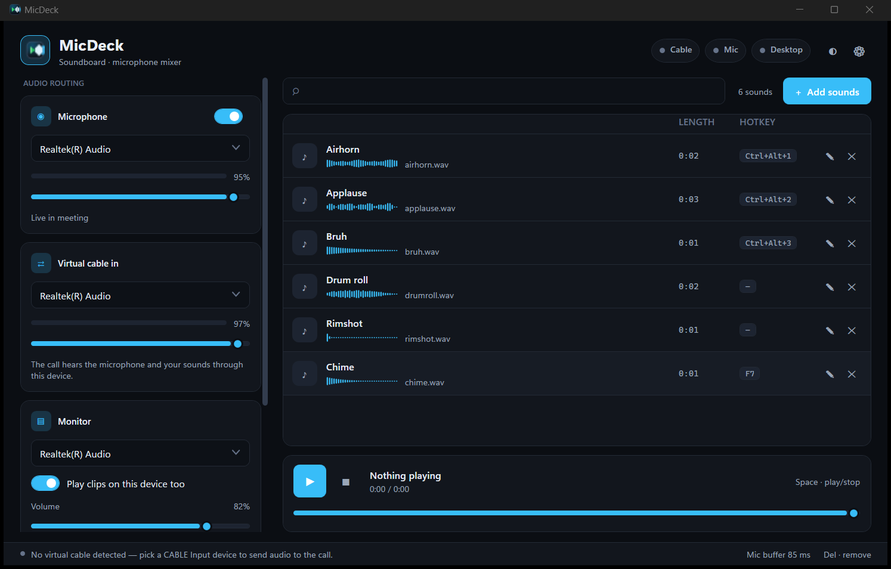
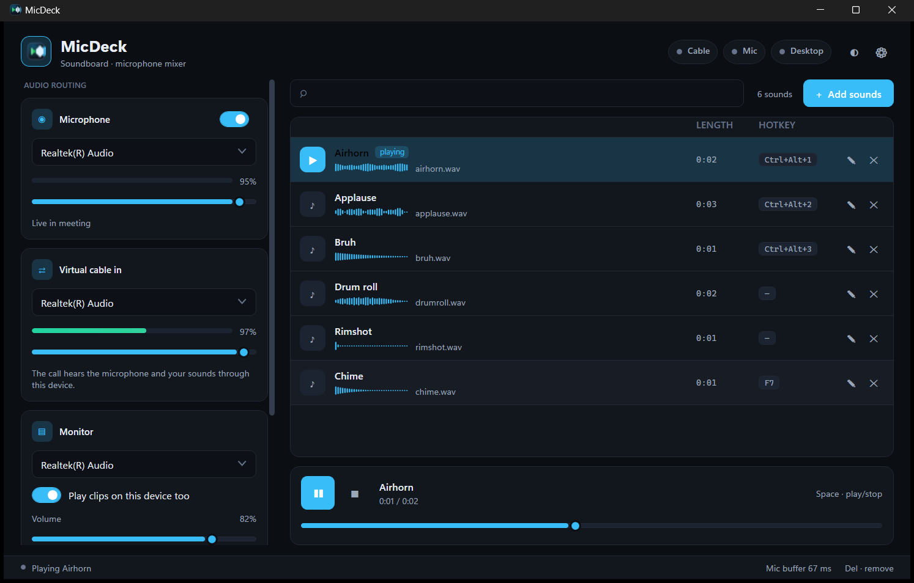
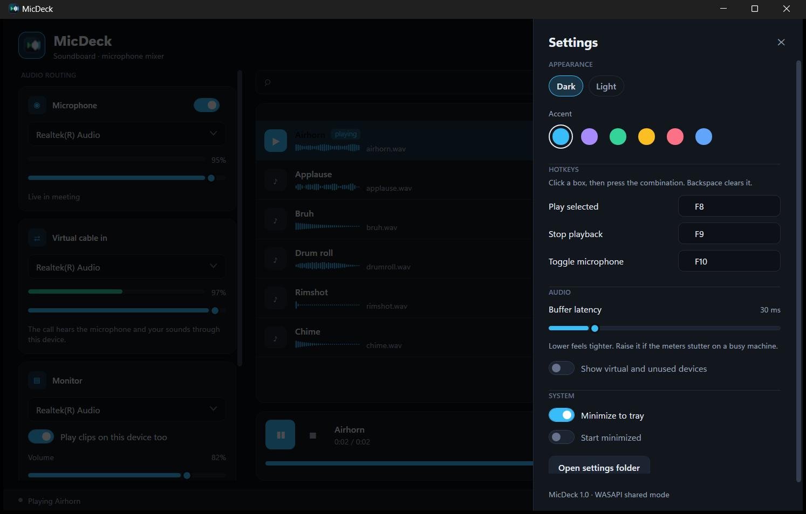
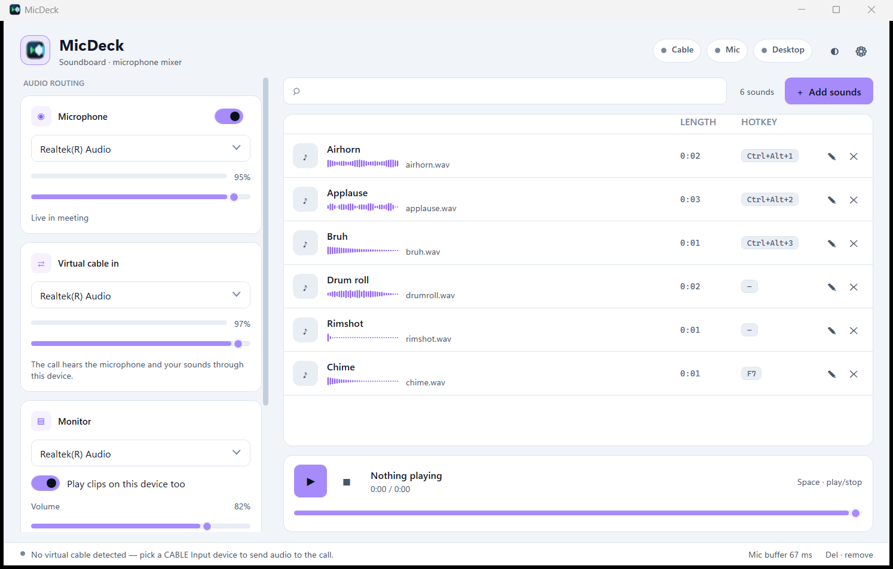

# MicDeck

**A soundboard and microphone mixer for Windows calls.** Play clips into a
meeting while your real microphone keeps working, and optionally mix desktop
audio in too.

[](https://github.com/Aws-Nassar/MicDeck/actions/workflows/build.yml)
[](#requirements)
[](#build-from-source)
[](LICENSE)



MicDeck is a native WPF app with its own WASAPI audio engine. There is no
Python runtime, no installer, and no unpacking on launch: it is one executable
that opens in about a second and stays open.

It works with anything that lets you choose a microphone: Discord, Zoom, Teams,
Google Meet, Slack, OBS, Steam, and browser-based calls.

## How it works

MicDeck takes over the microphone your call sees, and mixes your real
microphone and its own clips into that single stream:

```text
your microphone ─┐
MicDeck clips ──┼─▶ CABLE Input ═══ CABLE Output ─▶ meeting app microphone
desktop audio ───┘        ▲
                          │
              your headphones hear the same mix (optional)
```

Install [VB-CABLE](https://vb-audio.com/Cable/), point MicDeck at `CABLE Input`,
and tell the meeting app to use `CABLE Output`. That is the whole trick.

## Features

- **One continuous stream per output.** The soundboard, the microphone, and the
  desktop capture are inputs to a mixer that owns a single WASAPI stream, so
  starting or seeking a clip never reopens a device and never glitches.
- **Global hotkeys.** Bind any sound to a combination, plus play, stop, and
  microphone mute. They work while the call has focus. Conflicts are reported
  instead of silently failing.
- **Searchable library with waveforms.** Drag and drop files anywhere on the
  window. Rename, relink, or remove entries without touching the audio files.
- **Loudness-matched clips.** Every file is decoded once and normalised to about
  −18 dBFS RMS with a −1.4 dBFS peak ceiling, then cached in memory.
- **Drift-corrected capture.** Microphone and loopback audio are resampled by up
  to ±1 percent to hold a target buffer fill, which stops the slow drift that
  turns into clicks after a few minutes.
- **Desktop audio.** Capture any playback device with WASAPI loopback and mix it
  into the call. No "Stereo Mix" driver required.
- **Dark and light themes, six accents**, applied instantly and remembered.
- **Tray aware.** Minimise to tray or start there; the tray menu still plays,
  stops, and mutes.
- **Settings survive device changes.** Endpoints are stored as WASAPI ids, not
  indexes, so plugging in a headset no longer scrambles your routing.

## Requirements

```text
Windows 10 (1809 or newer) or Windows 11, 64-bit
.NET 10 Desktop Runtime, unless you use the self-contained build
VB-CABLE or another virtual audio cable
```

## Install

MicDeck is not on a store and has no installer. Build it yourself (below), or
grab `MicDeck.exe` from the artifacts of the latest
[CI run](https://github.com/Aws-Nassar/MicDeck/actions/workflows/build.yml) —
GitHub asks you to sign in before it hands out build artifacts. The exe is
self-extracting and needs no installation: put it wherever you like.

Then set up the routing once:

1. Install **VB-CABLE** and reboot if the installer asks.
2. Start MicDeck.
3. Set **Virtual cable in** to `CABLE Input (VB-Audio Virtual Cable)`.
4. Set **Microphone** to your real microphone, never to `CABLE Output`.
5. Set **Monitor** to your headphones or speakers.
6. In the meeting app, choose `CABLE Output (VB-Audio Virtual Cable)` as the
   microphone, and your headphones as the speaker.

The status bar tells you when routing is not pointing at a cable device, rather
than letting you discover it when nobody can hear you.

| Setting | Meaning |
| --- | --- |
| Virtual cable in | Where MicDeck sends audio. Use `CABLE Input`. |
| Microphone | Your real microphone, mixed into the cable. |
| Monitor | The device you personally hear clips on. |
| Desktop audio | A playback device whose audio is captured and mixed in. |

## Screenshots

**Playing a clip.** The row highlights, the transport tracks position, and the
cable meter shows what the call is receiving.



**Settings.** Appearance, hotkeys, buffer latency, and system behaviour all live
in one panel.



**Light theme, violet accent.** Themes and accents swap at runtime, including
the window chrome.



## Using sounds

- **Add sounds**, or drop audio files on the window. Anything Windows Media
  Foundation decodes works: WAV, MP3, M4A/AAC, WMA, and usually FLAC and OGG.
- Double-click a row to play it, or select it and press `Space`.
- Seek with the slider under the transport bar, even while a clip is playing.
- `✎` renames a sound, `✕` removes it from the library. The audio file itself is
  never deleted.
- If a file moves, the row shows `!`; double-click it to relink it. MicDeck then
  remembers the new path.

## Hotkeys

Hotkeys are real global hotkeys, registered with the OS, so they work while the
meeting app has focus. Defaults:

| Keys | Action |
| --- | --- |
| `F8` | Play the selected sound |
| `F9` | Stop playback |
| `F10` | Toggle the microphone |
| `Space` | Play or stop the selected sound (window focused) |
| `Del` | Remove the selected sound from the library |

Each sound can have its own hotkey: open **Settings → Hotkeys**, click a box,
and press the combination. Function keys work alone; letter and number keys need
at least one modifier. `Backspace` clears a binding. A combination another
application already owns shows a warning badge on the sound row.

## Themes

**Settings → Appearance** switches between the dark and light palettes and six
accent colours. Both apply immediately, without a restart, and the title bar
follows the theme.

Other settings:

| Setting | What it does |
| --- | --- |
| Buffer latency | 10–120 ms. Lower feels tighter; raise it on a busy machine. |
| Show virtual and unused devices | Lists endpoints that do not look useful by default. |
| Minimize to tray | Keeps hotkeys alive with the window hidden. |
| Start minimized | Launches straight to the tray. |

## Where settings live

```text
%APPDATA%\MicDeck\settings.json
```

The file is written atomically and debounced, so a crash cannot leave a
half-written settings file behind. A corrupt file is backed up next to it and
MicDeck starts with defaults instead of an empty library.

If a `config.json` from the old Python build is present in the same folder, its
sound list is imported on first run. Device indexes from that version are
deliberately dropped because they are not stable across device changes.

MicDeck used to be called LineCast. If `%APPDATA%\LineCast\settings.json` exists
and the new folder is empty, it is adopted on first launch rather than starting
you with an empty library.

## How the audio engine works

```text
ClipCache ─┐
Mic ───────┼─▶ AudioBus (mixer + limiter) ─▶ WasapiOut ─▶ device
Loopback ──┘          ▲
                      └── meter
```

Each output bus owns one `WasapiOut` stream and one mixer. Because clips are
mixer inputs rather than device owners, the device is opened once and stays open
for the life of the app.

- **Clock alignment.** The monitor and cable buses release a clip at the same
  `Stopwatch` timestamp with a 30 ms lead, so two devices with independent clocks
  still hear it together.
- **Capture drift.** A ring buffer resamples by up to ±1 percent to hold a target
  fill level. Without it, mismatched clocks slowly drain or overflow the buffer
  until the audio clicks.
- **No per-callback allocation.** Providers are pooled and reused; the render
  callback only copies floats, so the GC never runs in the audio thread.
- **Seeking is instant.** A seek restarts an in-memory clip source at a sample
  offset; nothing is decoded twice.
- **Stable routing.** Endpoints are identified by WASAPI id, so a USB headset
  coming and going cannot silently point your microphone at the wrong device.

## Troubleshooting

**The meeting app hears nothing.**

1. Check that **Virtual cable in** is `CABLE Input`, not your speakers.
2. Check that the meeting app's microphone is `CABLE Output`.
3. Check that **Microphone** is your real mic and that the mic switch is on.
4. Watch the meters: the mic meter should move when you speak, and the cable
   meter when a clip plays.

**Clips stutter or drop out.**

1. Raise **Buffer latency** in Settings.
2. Close applications holding the same device in exclusive mode.
3. Make sure monitor and cable are different endpoints.

**A hotkey does nothing.**

1. Open **Settings → Hotkeys** and look for a warning badge on the sound row.
2. Another application already owns the combination; pick another.

**Something crashed.** An error log is written to:

```text
%APPDATA%\MicDeck\error.log
```

## Build from source

Requires the [.NET 10 SDK](https://dotnet.microsoft.com/download).

```powershell
git clone https://github.com/Aws-Nassar/MicDeck.git
cd MicDeck
dotnet build MicDeck.sln -c Release
```

The app lands in:

```text
src\MicDeck\bin\x64\Release\net10.0-windows\MicDeck.exe
```

The helper script does the same thing, plus publishing:

```powershell
.\tools\build.ps1                 # Release build
.\tools\build.ps1 -Publish        # single-file, ReadyToRun -> dist\MicDeck.exe
```

If PowerShell refuses to run the script:

```powershell
powershell -ExecutionPolicy Bypass -File .\tools\build.ps1 -Publish
```

`-Publish` produces one self-extracting file, ReadyToRun compiled. ReadyToRun
matters here: it removes roughly a second of JIT time from a cold start.

To bundle the .NET runtime so the exe runs on machines that have never seen the
SDK:

```powershell
.\tools\build.ps1 -Publish -SelfContained
```

Ship `dist\MicDeck.exe` and nothing else in either case.

## Project layout

```text
MicDeck.sln                 solution root
src/MicDeck/
  App.xaml(.cs)              bootstrap, single instance, tray, deferred startup
  MicDeck.csproj            net10.0-windows, WPF + WinForms (tray only), NAudio
  Audio/
    AudioEngine.cs           buses, routing, transport
    AudioBus.cs              one WASAPI output stream and its mixer
    SampleProviders.cs       mixer, limiter, meter, clip player, channel map
    AdaptiveBuffer.cs        drift-correcting ring buffer
    CaptureConverter.cs      PCM conversion and downmix
    ClipCache.cs             decode once, normalise, LRU cache, waveforms
    AudioDeviceInfo.cs       WASAPI endpoint enumeration
  Configuration/             settings model, atomic store, v1 migration
  Controls/                  waveform and level-meter renderers
  Services/                  theme manager, global hotkeys, tray icon
  ViewModels/                main view model, sound rows, commands
  Views/                     main window, rename prompt
  Themes/                    dark and light palettes, control styles
docs/screenshots/            README images
tools/build.ps1              build and publish helper
.github/workflows/build.yml  CI: build on every push, upload the exe
```

## License

[MIT](LICENSE)
